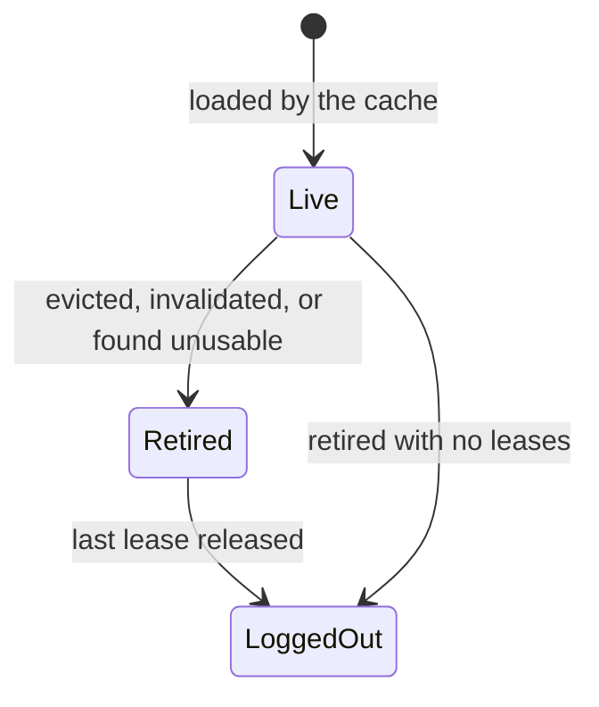

# BISERVER-15667: JCR cached-session lifecycle

This document records the problem behind BISERVER-15667 (pull request #6371), why it happened, what was changed, how the change was verified, and what it deliberately does not cover. It is written for someone who finds this code later and needs to know why it looks the way it does.

All code is in module `repository`, package `org.pentaho.platform.repository2.unified.jcr.sejcr`.

## 1. Background: how sessions are cached

Jackrabbit sessions are expensive to create, so `GuavaCachePoolPentahoJcrSessionFactory` keeps a Guava `LoadingCache` of sessions keyed by *(user, thread)*. A session is handed to `PentahoJcrTemplate.execute(...)`, which runs a callback with it. A session can also be bound to a Spring transaction (or to a read-only `SUPPORTS` synchronization) and then be used by several callbacks over the life of that operation.

The cache evicts by size (`cache-size`, default 100) and by idle time (`cache-ttl`, default 300 seconds). Those values are read from the `repository` system configuration in the factory constructor, via `ISystemConfig.getConfiguration( REPOSITORY_CONFIG_ID )`, before the Guava cache is created. The production defaults live in [assemblies/pentaho-solutions/src/main/resources/pentaho-solutions/system/repository.spring.properties](../assemblies/pentaho-solutions/src/main/resources/pentaho-solutions/system/repository.spring.properties), where they are defined as `cache-size=100` and `cache-ttl=300`. Eviction can happen at any moment, on any thread that touches the cache.

## 2. The problem

Before this change, ownership of a cached session was tracked only by a `usage_count` session attribute. When Guava evicted an entry, the removal listener logged the session out only if it was live and the counter was zero; otherwise it logged "may be orphaned" and did nothing.

That has two failure modes, and neither can be fixed by tuning the counter:

- **Closing a session that is in use.** The counter is incremented by the factory *after* the cache returns the session, and again by the template. An eviction between those steps, or a bound session between two callbacks, sees a count of zero and logs the session out underneath its owner. Symptoms are "session has been closed" style failures in the middle of an operation.
- **Leaking a session that was in use.** When the listener skips the logout because the count is non-zero, nothing ever logs the session out later, because the owner has no way to learn that the entry was evicted. The Jackrabbit session stays open until the JVM exits.

The cache holds a bare `Session`, so there is nowhere to record "this was evicted, close it when the last user is done" and no atomic way to decide between "in use" and "free".

### Further defects found while fixing it

Reproducing and reviewing the fix exposed other defects, in the original code or in intermediate versions of the fix. Each is covered by a test:

| Defect | Consequence |
|---|---|
| Cache size and TTL were read *after* the cache was built (a field initializer used the defaults) | Configured `cache-size` / `cache-ttl` were ignored because the values were being loaded from `ISystemConfig` too late |
| `credentialsStrategySessionFactory` was never assigned, so the thread-bound-session guard compared against `null` | The guard that stops a transaction-bound session being handed out again never fired |
| A session whose `refresh` failed stayed in the cache | Every later caller got the same broken session |
| Direct-login fallback sessions, and sessions whose proxy or listener setup failed, were never closed | Leaked sessions |
| Eviction logout ran synchronously inside Guava's removal notification | An unrelated caller loading its own session paid for another user's slow `logout()` |
| Cleanup ran on an unbounded cached thread pool | Slow or stuck logouts could each start a native thread |
| A bound session was closed between two callbacks of the same Spring operation | Premature close (found in the first version of the fix) |
| Cache acquisition retried without limit when every returned entry was evicted | Unbounded logins under continuous eviction (found in the first version of the fix) |
| DEBUG logging cast credentials to `SimpleCredentials` | `ClassCastException` for `GuestCredentials` |
| In CE, `PentahoTransactionManager` was not wired into the session cache | A `REQUIRES_NEW` transaction could be handed the session of the transaction it suspended (section 4.5) |

## 3. Solution overview

Each cached session is wrapped in a `CachedJcrSession` that counts who is using it and remembers whether it was evicted. Eviction *retires* the holder; the session is logged out exactly once, when the last user lets go. Everything else follows from that.

### 3.1 Leases

| Lease | Taken by | Released by |
|---|---|---|
| Factory hand-off (`acquire()`) | The cache factory when it returns a cached session | Consumed by the template (`consumeFactoryLease()`), or rolled back (`releaseUnhandedFactoryLease()`) if the hand-off fails |
| Callback use | The template, for the duration of `execute(...)` | `release()` in the template's `finally` block |
| Bound use (`acquireForBoundUse()`) | The template, when the session is already Spring-bound or is bound by this call | A transaction synchronization, in `afterCompletion`, once per holder per transaction scope |

Retirement only blocks *new* cache acquisitions. A callback that already holds the session, or a nested callback on a session Spring has bound, may still extend it while an earlier lease keeps it alive. A holder whose final lease has been released cannot be revived.

### 3.2 Components

- **`CachedJcrSession`**: the per-session state machine (`acquire`, `consumeFactoryLease`, `acquireForBoundUse`, `release`, `releaseUnhandedFactoryLease`, `retire`). State changes are synchronized per holder; `isLive()` and `logout()` run outside the monitor. Logout is claimed at most once, a session that is already closed is not logged out again, and a failing `logout()` is contained.
- **`GuavaCachePoolPentahoJcrSessionFactory`**:
  - Caches holders, not bare sessions; the loader attaches the holder and the legacy `usage_count` diagnostic counter to each session.
  - Reads size and TTL *before* building the cache. A size or TTL of zero selects a managed direct login instead of caching.
  - The removal listener retires holders asynchronously (section 4.1).
  - Tries the cache at most three times (a lookup can lose a race with eviction), then falls back to a managed direct login. Fallback sessions are tracked and retired up front so they close when the callback and any Spring binding finish.
  - Discards entries whose session is closed, already bound to a transaction, or fails `refresh`, rolling back the factory lease.
- **`CredentialsStrategySessionFactory`**: wires itself and the transaction manager into its cache delegate, whether the delegate is created lazily or injected. If proxy creation or listener registration fails, the session's lease and diagnostic count are rolled back, or a direct session is logged out, and the original exception is rethrown.
- **`PentahoJcrTemplate`**: distinguishes the factory hand-off from reuse of a bound session; registers a `TransactionSynchronization` that holds the bound lease until `afterCompletion` (so a session stays open between callbacks, across nested callbacks and across a suspended transaction); releases leases in `finally`; and never lets cleanup failures replace the callback's own exception.
- **`PentahoTransactionManager`**: registers itself with its session factory and reports when a `REQUIRES_NEW` transaction is being begun (section 4.5).

## 4. Design decisions

### 4.1 Eviction cleanup is asynchronous, on a bounded pool

Guava runs removal notifications on whichever thread triggered the eviction. `logout()` can do repository I/O, so the listener hands cleanup to a shared executor, and an unrelated caller is never delayed by another user's slow logout.

The pool has `MAX_CONCURRENT_EVICTION_CLEANUPS` (4) daemon threads that time out when idle. Cleanups beyond four wait in an **unbounded queue**. That is deliberate: a retired session must always be logged out eventually, so a cleanup is never rejected or dropped (that would leak the session) and never run on the evicting thread (that would bring back the latency). The queue only holds retired holders and grows only as fast as entries are evicted. The cost is that four stuck logouts silently stall cleanup until they return; there is no metric or warning for queue depth.

Because cleanup is asynchronous, **code and tests must not assume a session is closed the instant it is evicted**. Tests wait on a logout latch or a bounded deadline.

### 4.2 Why a holder rather than a smarter counter

Deciding "in use or free" and "evicted or not" has to be one atomic step, and the party that finishes last has to be the one that closes the session. A counter on the session cannot do either: the eviction listener and the last user race, and neither can tell the other what it saw. The holder serializes both decisions.

### 4.3 Bounded retries and managed fallback

Under continuous eviction, retrying the cache forever would log in forever. Three attempts then a direct login bounds the work and still gives the caller a session whose lifecycle is managed.

### 4.4 Failures during cleanup never mask the real failure

Releasing leases, decrementing diagnostic counters, logging out and discarding a failed hand-off are all contained: a failure is logged and the callback's own exception (or result) is what the caller sees. A missing diagnostic attribute must not prevent the lease from being released.

### 4.5 `REQUIRES_NEW` transactions get their own session

`PentahoTransactionManager` was introduced in 2016 so the cache could tell that a transaction was being created, and it was wired into the Spring configuration. This applies to the Community Edition (CE) only. In CE, the 2017 assembly restructuring carried an older copy of `repository.spring.xml` that still used `LocalTransactionManager`, so the wiring was lost and CE has run without it since.

The Enterprise Edition (`pentaho-platform-ee`) was not affected: its own `repository.spring.xml` still declares `PentahoTransactionManager` for both the user and the admin transaction manager, and passes `jcrTransactionManager` to the user session factory's cache. EE therefore needs no configuration change for this fix.

In CE, without the wiring, a `REQUIRES_NEW` transaction begun while another is suspended on the same thread was given the cached session the suspended transaction still owned. Spring unbinds the outer transaction's session holder during the suspension, so the thread-bound guard cannot see it. In practice the inner transaction fails to begin (`CannotCreateTransaction`); if it did begin on the shared session, its commit would save the outer transaction's unsaved changes.

The fix restores the wiring in CE, narrowly:

- `PentahoTransactionManager.setSessionFactory` registers the manager with its `CredentialsStrategySessionFactory`, which passes it to the cache delegate. `repository/src/main/resources/repository.spring.xml` and the deployed `assemblies/pentaho-solutions/.../system/repository.spring.xml` now declare `PentahoTransactionManager` for the user and admin managers.
- `isCreatingIndependentTransaction()` is true only while a `REQUIRES_NEW` transaction is being begun. Only then does the cache factory perform a direct login that never enters the cache.
- **`REQUIRED`, `NESTED` and `SUPPORTS` keep using the cached session in CE, as before.** The 2016 predicate, `isCreatingTransaction()`, also bypassed the cache for `REQUIRED` and `NESTED`. Restoring that would make every transaction log in afresh, a platform-wide cost and behavior change. When it was tried, one existing integration test (`JcrAclNodeHelperIT.canDeleteTargetIfAclNodeRemoved`) failed, because it relies on a lazily loaded `RepositoryFileProxy` keeping a live session. If it is ever restored it needs its own performance measurement and that test adjusted.

## 5. Behavior and configuration notes

- `cache-size` and `cache-ttl` (repository system configuration) now take effect. Setting either to `0` disables caching: each use is one managed direct login that closes when its callback and any Spring binding finish.
- A session that Spring has bound to a transaction stays open until the transaction completes, even if it is evicted meanwhile.
- A session logged out outside the cache is discarded and replaced on the next acquisition.
- The Spring files under `extensions/src/test/resources` and `extensions/src/it/resources` are test harness copies and still use `LocalTransactionManager`; they do not get the `REQUIRES_NEW` isolation.

## 6. Verification

### 6.1 Test layout

- **Unit tests** (`repository/src/test`, Surefire): `CachedJcrSessionTest` (lease transitions, retirement, no revival, logout failures, concurrent retirement against final release), `GuavaCachePoolPentahoJcrSessionFactoryTest` and `GuavaCachePoolPentahoJcrRaceConditionTest` (configuration, bounded retries, refresh and fallback cleanup, closed-session replacement, the bounded and non-blocking asynchronous eviction, the `REQUIRES_NEW` bypass), `PentahoJcrTemplateTest` (usage accounting, security translation, bound-lease retention until completion, unusable and unprotectable sessions, contained cleanup failures), `CredentialsStrategySessionFactoryTest` (delegate wiring, failed hand-off cleanup), `PentahoTransactionManagerTest`.
- **Integration tests** (`repository/src/it`, Failsafe, activated with `-DrunITs`): `GuavaCachePoolPentahoJcrOrphanedSessionIT` runs against a real Jackrabbit repository: eviction during and after callbacks, failing callbacks, externally closed sessions, read-only and nested bound callbacks, commit and rollback, 12 workers × 16 rounds of concurrent real sessions, lazily loaded files and binary streams that outlive their session, `REQUIRES_NEW` suspension and resumption, the Spring wiring, and `REQUIRES_NEW` isolation. `GuavaCachePoolPentahoJcrSessionStressIT` and `CachedJcrSessionStressIT` are opt-in stress cases (50,000 operations per scenario; 200,000 simultaneously live holders). They use lightweight session fixtures, not 200,000 real Jackrabbit sessions.

To run everything: `mvn --batch-mode -o -pl repository -DrunITs verify`.

### 6.2 Evidence that the tests detect the defects

- Against the original implementation, the real-repository concurrency case leaves evicted sessions open after their callbacks, and a read-only `SUPPORTS` operation had its session closed between callbacks by the first version of the fix. Both fail without the fix.
- With the old XML, the two `REQUIRES_NEW` integration tests fail: the wiring check, and the isolation test, which fails with `CannotCreateTransaction`.
- Temporarily restoring the unchecked `SimpleCredentials` cast reproduces the `GuestCredentials` DEBUG failure.

### 6.3 Results for this change

The full module run passed 424 unit tests and 167 integration tests with no failures, errors or skips.

A microbenchmark comparing the original and the fixed lifecycle logic with lightweight sessions (two JVM forks per revision, identical harness, 400,000 operations per sample) showed no regression: cache-hit throughput was within run-to-run noise (about 5.1 M versus 5.5 M ops/s), churn throughput was unchanged (about 805 K ops/s), and allocation per 400,000 operations was lower (churn: about 267 MiB versus 218 MiB). It measured lifecycle bookkeeping only and was taken before the bounded eviction pool and the `REQUIRES_NEW` bypass; it says nothing about repository I/O, disk-backed throughput or real concurrent sessions.

## 7. Known limits

- `RepositoryFileProxy` has a live-session fast path that can operate on its retained `Node` without going through the template. Closed-session reload and returned-stream compatibility are tested; a race between that fast path and eviction is not claimed to be solved.
- Sessions that are not Jackrabbit `SessionImpl` cannot carry the holder attribute, so they are not lifecycle-tracked. Raw consumers of the factory and transactions that never enter `PentahoJcrTemplate` were not established as safe.
- A `logout()` that throws is contained and logged, and exactly-once initiation is preserved, but the repository may not have freed that session.
- Eviction cleanup has no queue-depth metric (section 4.1).
- `REQUIRED` and `NESTED` transactions still share the thread's cached session (section 4.5).
