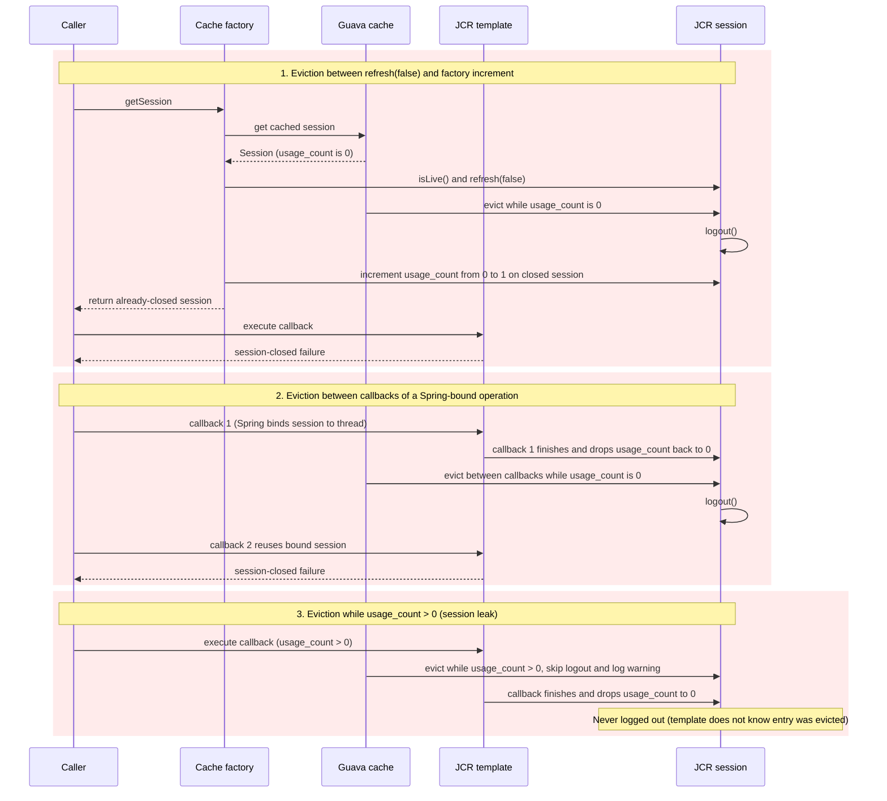
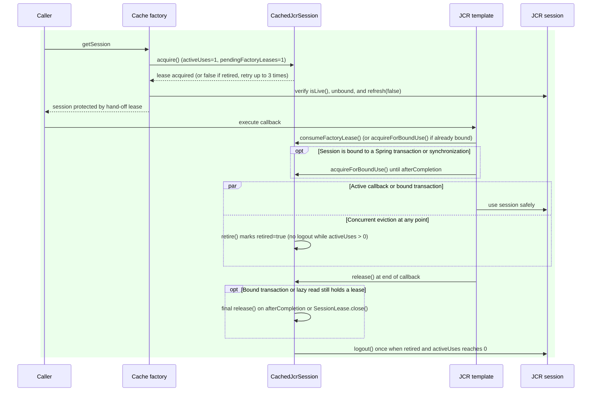
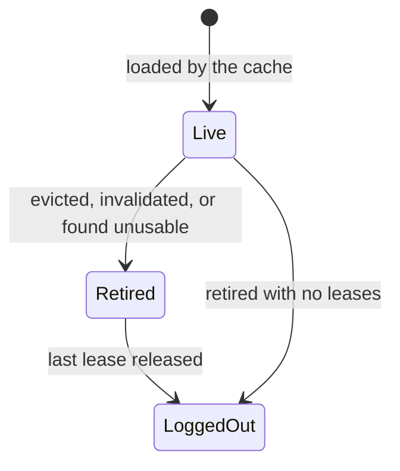
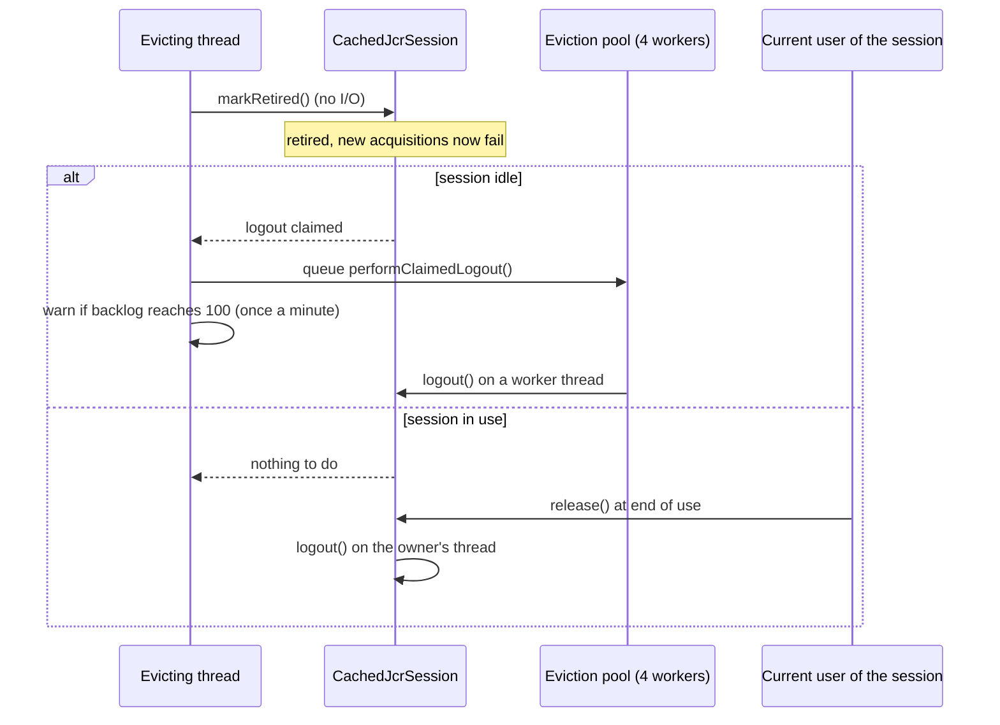
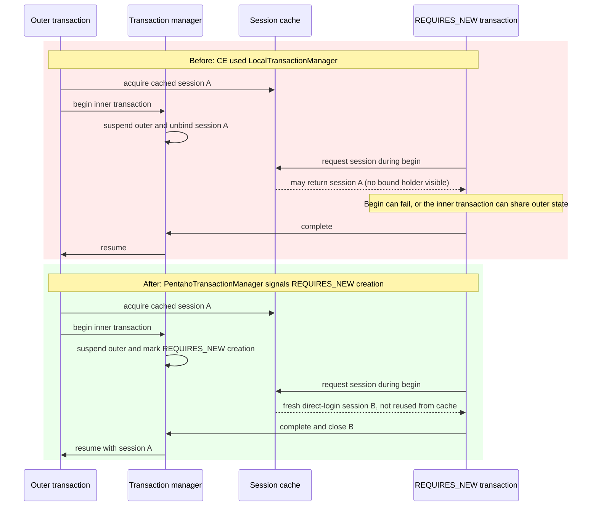
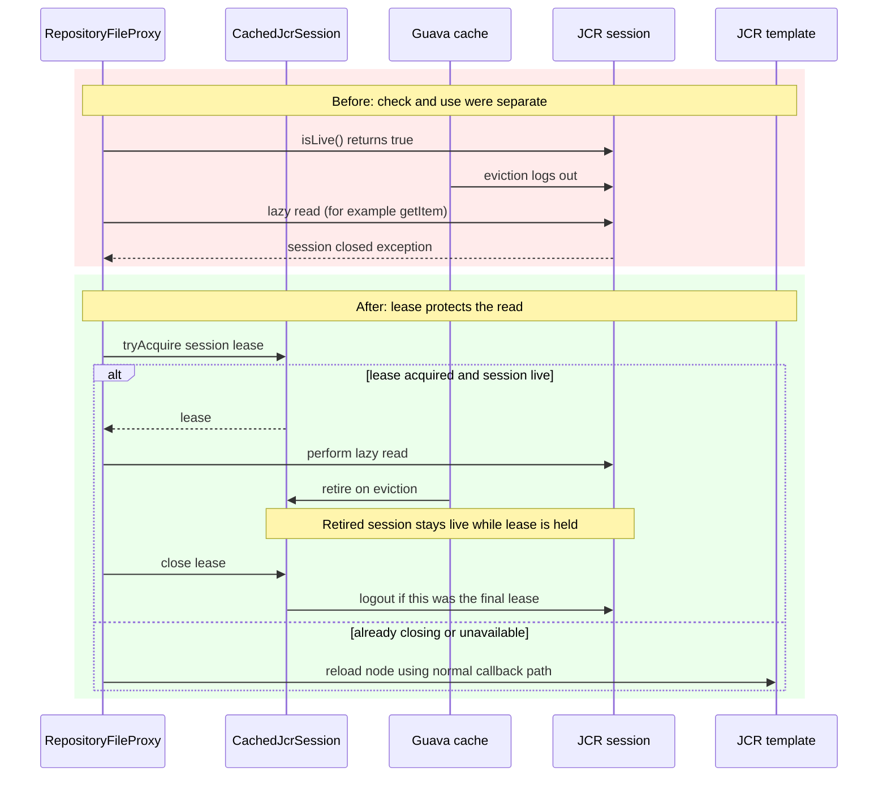

# BISERVER-15667: JCR cached-session lifecycle

This document records the problem behind BISERVER-15667 (pull request #6371), why it happened, what was changed, how the change was verified, and what it deliberately does not cover. It is written for someone who finds this code later and needs to know why it looks the way it does.

All code is in module `repository`, package `org.pentaho.platform.repository2.unified.jcr.sejcr`.

## Relationship to BISERVER-14405 and PR #6329

This change continues the JCR session-cache work from [PR #6329](https://github.com/pentaho/pentaho-platform/pull/6329), which was merged for BISERVER-14405. That PR addressed the excessive log and disk growth caused by cache eviction: it guarded eviction of dead or in-use sessions, restored `PentahoJcrTemplate` wiring so the cache's usage protection was applied, fixed tenant-manager stack-trace logging, and repaired and re-enabled `FileResourceIT` and `UserRoleDaoIT`.

Those changes reduced the log-growth symptoms and restored the affected tests, but they did not establish safe ownership of a cached session across acquisition, template callbacks, transaction binding, eviction, and lazy reads. In particular, a session could still be logged out while an operation was using it, or remain open after eviction because no owner was responsible for its eventual logout. PR #6371 (BISERVER-15667) continues that work by adding explicit session leases and coordinating retirement with the final release. Therefore, PR #6329 alone does not fully address the session-lifecycle problem tracked by the Jira; this follow-up addresses the remaining ownership and cleanup races described below.

## 1. Background: how sessions are cached

Jackrabbit sessions are expensive to create, so `GuavaCachePoolPentahoJcrSessionFactory` keeps a Guava `LoadingCache` of sessions keyed by *(user, thread)*. A session is handed to `PentahoJcrTemplate.execute(...)`, which runs a callback with it. A session can also be bound to a Spring transaction (or to a read-only `SUPPORTS` synchronization) and then be used by several callbacks over the life of that operation.

The cache evicts by size (`cache-size`, default 100) and by idle time (`cache-ttl`, default 300 seconds). Those values are read from the `repository` system configuration in the factory constructor, via `ISystemConfig.getConfiguration( REPOSITORY_CONFIG_ID )`, before the Guava cache is created. The production defaults live in [assemblies/pentaho-solutions/src/main/resources/pentaho-solutions/system/repository.spring.properties](../assemblies/pentaho-solutions/src/main/resources/pentaho-solutions/system/repository.spring.properties), where they are defined as `cache-size=100` and `cache-ttl=300`. Eviction can happen at any moment, on any thread that touches the cache.

## 2. The problem

Before this change, ownership of a cached session was tracked only by a `usage_count` session attribute. When Guava evicted an entry, the removal listener logged the session out only if it was live and the counter was zero; otherwise it logged "may be orphaned" and did nothing.

That has two failure modes, and neither can be fixed by tuning the counter:

- **Closing a session that is in use.** The counter is incremented by the factory *after* the cache returns the session, and again by the template. An eviction between those steps, or a bound session between two callbacks, sees a count of zero and logs the session out underneath its owner. Symptoms are "session has been closed" style failures in the middle of an operation.
- **Leaking a session that was in use.** When the listener skips the logout because the count is non-zero, nothing ever logs the session out later, because the owner has no way to learn that the entry was evicted. The Jackrabbit session stays open until the JVM exits.

The cache holds a bare `Session`, so there is nowhere to record "this was evicted, close it when the last user is done" and no atomic way to decide between "in use" and "free".

### Before and after: ownership during eviction

In the original code, `usage_count` could not coordinate eviction with active use in three places:

1. **Hand-off race in the factory:** `getSession` checked `isLive()` and called `refresh(false)` before incrementing `usage_count`. An eviction in that window saw `usage_count == 0` and logged the session out before the factory incremented the counter and returned it.
2. **Gap between callbacks of a bound operation:** `PentahoJcrTemplate`'s `finally` block decremented both the callback count and the factory count at the end of every callback, dropping `usage_count` to `0` even when Spring still held the session bound for a transaction or `SUPPORTS` scope. An eviction before the next callback saw `usage_count == 0` and closed the bound session.
3. **Eviction while in use (session leak):** when eviction ran while `usage_count > 0`, the removal listener logged `"May be orphaned"` and skipped `logout()`, and nothing logged the session out after the owner later decremented `usage_count` to `0`.

With `CachedJcrSession`, acquisition and retirement coordinate through leases on the holder. If eviction wins before the factory can acquire a lease, `acquire()` returns `false` and the factory retries (up to three attempts before falling back to a managed direct login). Once a lease is held, eviction only marks the holder retired, and the last owner to release its lease performs the single logout.

### Further defects found while fixing it

Reproducing and reviewing the fix exposed other defects, in the original code or in intermediate versions of the fix. Each is covered by a test:

| Defect | Consequence |
|---|---|
| Cache size and TTL were read *after* the cache was built (a field initializer used the defaults) | Configured `cache-size` / `cache-ttl` were ignored because the values were being loaded from `ISystemConfig` too late |
| `credentialsStrategySessionFactory` was never assigned, so the thread-bound-session guard compared against `null` | The guard that stops a transaction-bound session being handed out again never fired |
| The thread-bound guard compared the cached session with the object Spring binds, which is the logout-suppressing proxy from `CredentialsStrategySessionFactory` | Even once wired, the guard could never match in production; it now unwraps the proxy before comparing |
| A transaction begin takes a factory lease that only a template callback consumes | A read-only transaction that never ran a callback kept the lease forever, so the session could not be closed after eviction; `PentahoTransactionManager` now hands an unconsumed lease back on completion |
| A session whose `refresh` failed stayed in the cache | Every later caller got the same broken session |
| Direct-login fallback sessions, and sessions whose proxy or listener setup failed, were never closed | Leaked sessions |
| Eviction logout ran synchronously inside Guava's removal notification | An unrelated caller loading its own session paid for another user's slow `logout()` |
| Cleanup ran on an unbounded cached thread pool | Slow or stuck logouts could each start a native thread |
| Retirement itself was queued on the bounded cleanup pool (found in review of an intermediate version of the fix) | While logouts were stuck, an evicted session stayed acquirable and a session evicted while in use stayed open after its last user finished; now the holder is retired on the evicting thread and only the idle logout is queued (section 4.1) |
| A bound session was closed between two callbacks of the same Spring operation | Premature close (found in the first version of the fix) |
| Cache acquisition retried without limit when every returned entry was evicted | Unbounded logins under continuous eviction (found in the first version of the fix) |
| DEBUG logging cast credentials to `SimpleCredentials` | `ClassCastException` for `GuestCredentials` |
| In CE, `PentahoTransactionManager` was not wired into the session cache | A `REQUIRES_NEW` transaction could be handed the session of the transaction it suspended (section 4.5) |
| `RepositoryFileProxy` objects are resolved lazily, after the callback that created them, and nothing kept their cached session open | Once eviction closed that session, the lazy read failed: `This session has been closed` logged as ERROR, a missing value, or an HTTP 500 on a listing (section 4.6) |

## 3. Solution overview

Each cached session is wrapped in a `CachedJcrSession` that counts who is using it and remembers whether it was evicted. Eviction *retires* the holder; the session is logged out exactly once, when the last user lets go. Everything else follows from that. One pre-existing exception: a session bound to a Spring transaction is still logged out directly by the transaction manager when the transaction ends (section 4.8).

### 3.1 Leases

| Lease | Taken by | Released by |
|---|---|---|
| Factory hand-off (`acquire()`) | The cache factory when it returns a cached session | Consumed by the template (`consumeFactoryLease()`), or rolled back (`releaseUnhandedFactoryLease()` / `releaseUnconsumedFactoryLease()`) if the hand-off fails or a transaction completes without a callback |
| Callback use | The template, for the duration of `execute(...)` | `release()` in the template's `finally` block |
| Bound use (`acquireForBoundUse()`) | The template, when the session is already Spring-bound or is bound by this call | A transaction synchronization, in `afterCompletion`, once per holder per transaction scope |
| Lazy read (`SessionLease`) | `RepositoryFileProxy`, for the duration of one lazy read outside any callback | `SessionLease.close()` in the proxy's `try`-with-resources; closing the last lease of a retired session logs it out |

Retirement only blocks *new* cache acquisitions. A callback that already holds the session, or a nested callback on a session Spring has bound, may still extend it while an earlier lease keeps it alive. A holder whose final lease has been released cannot be revived.

### 3.2 Components

- **`CachedJcrSession`**: the per-session state machine (`acquire`, `consumeFactoryLease`, `acquireForBoundUse`, `release`, `releaseUnhandedFactoryLease`, `releaseUnconsumedFactoryLease`, `retire`). State changes are synchronized per holder; `isLive()` and `logout()` run outside the monitor. Logout is claimed at most once, a session that is already closed is not logged out again, and a failing `logout()` is contained.
- **`GuavaCachePoolPentahoJcrSessionFactory`**:
  - Caches holders, not bare sessions; the loader attaches the holder and the legacy `usage_count` diagnostic counter to each session.
  - Reads size and TTL *before* building the cache. A size or TTL of zero selects a managed direct login instead of caching.
  - The removal listener retires holders immediately and sends only idle sessions' logouts to a bounded pool (section 4.1).
  - Sends credentials that are not `SimpleCredentials` (for example `GuestCredentials`) straight to a managed direct login, because the cache key is built from `SimpleCredentials`.
  - Tries the cache at most three times (a lookup can lose a race with eviction), then falls back to a managed direct login. In every case, "direct" means a fresh `repository.login(creds, workspace)` without cache reuse; it uses the same credentials supplied for that request and does not bypass repository authentication or authorization. Invalid credentials are still rejected; anonymous credentials (such as `GuestCredentials`, or `null` if supplied) work only if the repository is configured to allow them. Fallback sessions are tracked and retired up front so they close when the callback and any Spring binding finish.
  - Discards entries whose session is closed, already bound to a transaction (unwrapping the `CredentialsStrategySessionFactory` proxy that Spring binds), or fails `refresh`, rolling back the factory lease.
- **`CredentialsStrategySessionFactory`**: wires itself and the transaction manager into its cache delegate, whether the delegate is created lazily or injected. If proxy creation or listener registration fails, the session's diagnostic count is rolled back and its lease is released even if that counter cannot be read (or a direct session is logged out), and the original exception is rethrown. The logout-suppressing proxy forwards `logout()` only while the session is still live: Spring runs transaction synchronizations (which can release the last lease and log the session out) before the transaction manager closes its bound proxy, so the manager's later `logout()` must not reach the session a second time.
- **`PentahoJcrTemplate`**: distinguishes the factory hand-off from reuse of a bound session; registers a `TransactionSynchronization` that holds the bound lease until `afterCompletion` (so a session stays open between callbacks, across nested callbacks and across a suspended transaction); releases leases in `finally`; and never lets cleanup failures replace the callback's own exception.
- **`PentahoTransactionManager`**: registers itself with its session factory, reports when a `REQUIRES_NEW` transaction is being begun (section 4.5), and in `doCleanupAfterCompletion` hands back any factory lease that no template callback consumed.
- **`SessionLease`** (public, same package): a short claim on a cached session for code that uses it outside a template callback. `tryAcquire( session )` returns a lease, a no-op lease for a session without a lifecycle holder, or nothing when the session is already closed or closing. It reuses `acquireForBoundUse()`, so no new lifecycle state exists.
- **`RepositoryFileProxy`**: each lazy read holds a `SessionLease` while it runs. If no lease can be taken, or the session is no longer live, it reloads its node through the template exactly as before (section 4.6).

## 4. Design decisions

### 4.1 Eviction retires immediately; idle logouts run on a bounded pool

Guava runs removal notifications on whichever thread triggered the eviction. The listener therefore does only cheap work on that thread and hands the repository I/O to a shared executor, so an unrelated caller is never delayed by another user's slow `logout()`:

1. **Retire now, on the evicting thread.** `CachedJcrSession.markRetired()` is a short synchronized state change with no I/O. From that moment, no caller can acquire the evicted session.
2. **Session in use:** nothing is queued. The session's last user logs it out when it releases its lease, as soon as its work ends.
3. **Session idle:** `markRetired()` claims the logout, and only the `logout()` call is queued on the executor (`performClaimedLogout()`).

The pool has `MAX_CONCURRENT_EVICTION_CLEANUPS` (4) daemon threads that time out when idle. Logouts beyond four wait in an **unbounded queue**. That is deliberate, because every alternative is worse: rejecting or dropping a logout leaks the session permanently, running it on the evicting thread brings the latency back, and blocking stalls every caller that loads a session.

Every queued entry is an idle session that is already retired. The queue cannot grow without limit on its own: each queued logout belongs to a session that was earlier logged in through the cache, so the backlog is at most the cache size plus the logins that succeed while logouts are stuck. If the repository is hung, logins usually stall too. If only logout is stuck, the backlog keeps growing at the login rate, and those sessions stay open until their logout runs.

When the backlog reaches `EVICTION_QUEUE_WARNING_THRESHOLD` (100) queued logouts, the factory logs a warning (`JCR session eviction cleanup is falling behind: ...`), at most once a minute per factory. Before this warning, a stuck cleanup was silent.

Because the idle logout is asynchronous, **code and tests must not assume an idle session is closed the instant it is evicted**. Tests wait on a logout latch or a bounded deadline.

Only idle evictions are moved off request threads. When a session is in use at eviction, its logout runs on whichever thread releases the last lease: a template's `finally` block, a transaction synchronization's `afterCompletion`, or a `RepositoryFileProxy` lazy read. These are request threads, so under constant eviction a request can pay for one logout. This is deliberate: sending every final logout to the pool would add to the same queue and change when sessions are closed, which tests and callers rely on.

### 4.2 Why a holder rather than a smarter counter

Deciding "in use or free" and "evicted or not" has to be one atomic step, and the party that finishes last has to be the one that closes the session. A counter on the session cannot do either: the eviction listener and the last user race, and neither can tell the other what it saw. The holder serializes both decisions.

### 4.3 Bounded retries and managed fallback

Under continuous eviction, retrying the cache forever would log in forever. Three attempts then a direct login bounds the work and still gives the caller a session whose lifecycle is managed.

### 4.4 Failures during cleanup never mask the real failure

Releasing leases, decrementing diagnostic counters, logging out and discarding a failed hand-off are all contained: a failure is logged and the callback's own exception (or result) is what the caller sees. A missing diagnostic attribute must not prevent the lease from being released.

### 4.5 `REQUIRES_NEW` transactions get their own session

`PentahoTransactionManager` was introduced in 2016 so the cache could tell that a transaction was being created, and it was wired into the Spring configuration. This applies to the Community Edition (CE) only. In CE, the 2017 assembly restructuring carried an older copy of `repository.spring.xml` that still used `LocalTransactionManager`, so the wiring was lost and CE has run without it since.

The Enterprise Edition (`pentaho-platform-ee`) was not affected: its own `repository.spring.xml` still declares `PentahoTransactionManager` for both the user and the admin transaction manager, and passes `jcrTransactionManager` to the user session factory's cache. EE therefore needs no configuration change for this fix.

In CE, without the wiring, a `REQUIRES_NEW` transaction begun while another is suspended on the same thread was given the cached session the suspended transaction still owned. Spring unbinds the outer transaction's session holder during the suspension, so the thread-bound guard cannot see it. In practice the inner transaction fails to begin (`CannotCreateTransaction`); if it did begin on the shared session, its commit would save the outer transaction's unsaved changes.

The distinction is the session chosen while the inner transaction is being created:

The fix restores the wiring in CE, narrowly:

- `PentahoTransactionManager.setSessionFactory` registers the manager with its `CredentialsStrategySessionFactory`, which passes it to the cache delegate. `repository/src/main/resources/repository.spring.xml` and the deployed `assemblies/pentaho-solutions/.../system/repository.spring.xml` now declare `PentahoTransactionManager` for the user and admin managers.
- `isCreatingIndependentTransaction()` is true only while a `REQUIRES_NEW` transaction is being begun. Only then does the cache factory perform a direct login that never enters the cache.
- **`REQUIRED`, `NESTED` and `SUPPORTS` keep using the cached session in CE, as before.** The 2016 predicate, `isCreatingTransaction()`, also bypassed the cache for `REQUIRED` and `NESTED`. Restoring that would make every transaction log in afresh, a platform-wide cost and behavior change. When it was tried, one existing integration test (`JcrAclNodeHelperIT.canDeleteTargetIfAclNodeRemoved`) failed, because it relies on a lazily loaded `RepositoryFileProxy` keeping a live session. If it is ever restored it needs its own performance measurement and that test adjusted.

### 4.6 Lazy reads hold a lease instead of racing eviction

`RepositoryFileProxy` is returned to callers and resolves its fields (name, title, dates, metadata, id) on first use, often while the response is being built, long after the callback ended. Its `executeOperation` checked `session.isLive()` and then used the session. Nothing kept the session open between the two steps, so eviction could log it out in between. Because every lazy getter catches `RepositoryException` and logs it, the symptom was an ERROR line plus a missing value, and sometimes an `IllegalStateException` from Jackrabbit's access manager that surfaced as an HTTP 500.

The read now takes a `SessionLease` first. Eviction can retire the session while the read runs, but the logout waits for the lease to close. If the lease cannot be taken (the session is already closed or closing) or the session is not live, the proxy reloads its node through the template, as it already did for a closed session.

A retry was considered and rejected. The getters swallow the exception inside the operation, so a retry in `executeOperation` would first require reworking about 25 getters. A grace period before logout only narrows the window. The lease closes it with an existing primitive and about 30 changed lines.

A retired session whose last lease is a lazy read is logged out on the reading thread when that read ends, so the next lazy read on the same proxy reloads. That costs one reload per lazy read under constant eviction, which is the expected price of a tiny cache.

### 4.7 Factory leases are per-session counters (known limitation)

A factory handoff is recorded as the `pendingFactoryLeases` and `activeUses` counters of the session's `CachedJcrSession`, not as a token owned by the caller. The JCR and Spring APIs only pass a `Session` around, so there is no place to carry a per-handoff token without new plumbing. A release therefore means "release one pending lease on this session", not "release my lease". At transaction cleanup, `releaseUnconsumedFactoryLease()` can roll back a pending handoff that belongs to another `getSession()` caller on the same thread.

Mitigations in place:

- A release never takes a counter below zero, and a factory-lease release never falls back to taking an `activeUses` lease that belongs to a running callback or a Spring binding.
- `releaseUnconsumedFactoryLease()` checks for a pending lease and releases it under one lock, so a concurrent consumption cannot slip in between.
- A mismatch changes no state and is logged at ERROR with a stack trace (`Factory lease release without a matching lease ...` or `Release without a matching lease ...`). It does not throw, because releases run in `finally` and cleanup paths (section 4.4).

An ERROR of this kind means some caller has a bookkeeping bug. It should be investigated, not suppressed. None were logged in any of the load tests in section 6.3.

TODO (follow-up ticket): carry a per-handoff lease token in the logout-suppressing proxy created by `CredentialsStrategySessionFactory`, with an idempotent release, and have the template, the transaction cleanup and the failed-handoff path release that token. Section 8 lists possible directions that would provide this ownership model directly.

### 4.8 Transactions end with a direct logout (pre-existing, known limitation)

At the end of every Spring transaction, se-jcr's `LocalTransactionManager.doCleanupAfterCompletion` calls `logout()` on the bound session proxy. The proxy forwards the logout unless the transaction is read-only, but Spring clears the read-only flag (`TransactionSynchronizationManager.clear()`) before that cleanup runs, so the logout is always forwarded. This behavior dates from 2016 and is not introduced by this change. Its consequences:

- The session is closed behind its `CachedJcrSession`: the holder is not retired, and the dead entry stays in the cache until the next acquisition finds it closed and replaces it (section 5).
- A lease that is still held, such as a `RepositoryFileProxy` lazy read, has its session closed underneath it. The proxy then reloads (section 4.6).
- The exactly-once logout of section 3 does not apply to sessions bound to a transaction. The `isLive()` checks in the proxy and in `CachedJcrSession` make the second close a silent no-op instead of an error.

This is not changed here. Making the proxy's `logout()` retire the holder instead (so the holder owns the logout) would respect outstanding leases, but on its own it can leak sessions: code that takes a session from the factory and logs it out without going through the template never releases its factory lease, so a retired holder would wait forever. That needs per-handoff ownership (section 4.7) first.

## 5. Behavior and configuration notes

- `cache-size` and `cache-ttl` (repository system configuration) now take effect. Setting either to `0` disables caching: each use is one managed direct login that closes when its callback and any Spring binding finish.
- A session that Spring has bound to a transaction stays open until the transaction completes, even if it is evicted meanwhile.
- A session logged out outside the cache is discarded and replaced on the next acquisition.
- The Spring files under `extensions/src/test/resources` and `extensions/src/it/resources` are test harness copies and still use `LocalTransactionManager`; they do not get the `REQUIRES_NEW` isolation.
- **Diagnosing login failures.** The cache loader only calls `repository.login`, so an exception there (for example `LoginException: Workspace access denied`, wrapped by Guava in an `ExecutionException`) is a login failure, not a cache problem. It used to be logged as `Error obtaining session from cache`. It is now logged as `Repository login failed while loading a cached JCR session: user=... workspace=... thread=...`, followed by the outcome of the existing direct-login retry:
  - `Direct login retry succeeded ... The first failure was transient.` (WARN): the denial did not repeat. Look for timing or context issues on that thread.
  - `Direct login retry also failed ...` (ERROR): the repository consistently denies this user or workspace. Check that the user still exists and is enabled, and its access to that workspace; the session cache cannot fix this.

  The user ID, workspace and thread name are logged; the password and credential attributes (such as the pre-authentication token) are not.

## 6. Verification

### 6.1 Test layout

- **Unit tests** (`repository/src/test`, Surefire): `CachedJcrSessionTest` (lease transitions, retirement, retiring without I/O and handing the claimed logout to the caller, a factory-lease rollback without a pending lease never taking a running template's lease, no revival, logout failures, concurrent retirement against final release), `SessionLeaseTest` (lease on tracked, untracked and closed sessions, deferred logout, idempotent close), `RepositoryFileProxyLeaseTest` (a lazy read holds its lease, reloads when the session is closing, keeps the old behavior for untracked sessions, releases the lease when the read fails), `GuavaCachePoolPentahoJcrSessionFactoryTest` and `GuavaCachePoolPentahoJcrRaceConditionTest` (configuration, bounded retries, refresh and fallback cleanup, closed-session replacement, the bounded and non-blocking eviction cleanup, a session evicted while in use closing on its last release even when every cleanup worker is stalled, the rate-limited backlog warning, cache-loader login failures logged with user, workspace and thread and with the retry's outcome, without secrets, the `REQUIRES_NEW` bypass), `PentahoJcrTemplateTest` (usage accounting, security translation, bound-lease retention until completion, unusable and unprotectable sessions, contained cleanup failures), `CredentialsStrategySessionFactoryTest` (delegate wiring, failed hand-off cleanup), `PentahoTransactionManagerTest`.
- **Integration tests** (`repository/src/it`, Failsafe, activated with `-DrunITs`): `GuavaCachePoolPentahoJcrOrphanedSessionIT` runs against a real Jackrabbit repository: eviction during and after callbacks, failing callbacks, externally closed sessions, read-only and nested bound callbacks, commit and rollback, 12 workers × 16 rounds of concurrent real sessions, lazily loaded files and binary streams that outlive their session, `REQUIRES_NEW` suspension and resumption, the Spring wiring, and `REQUIRES_NEW` isolation. `RepositoryFileProxyEvictionIT` runs against a real Jackrabbit repository too: one test retires the session at the first repository access inside each lazy read (the deterministic form of eviction landing between the liveness check and the read), and one reads proxies from 8 threads while another thread keeps evicting the cache. `GuavaCachePoolPentahoJcrSessionStressIT` and `CachedJcrSessionStressIT` are opt-in stress cases (50,000 operations per scenario; 200,000 simultaneously live holders). They use lightweight session fixtures, not 200,000 real Jackrabbit sessions.

To run everything: `mvn --batch-mode -o -pl repository -DrunITs verify`.

### 6.2 Evidence that the tests detect the defects

- Against the original implementation, the real-repository concurrency case leaves evicted sessions open after their callbacks, and a read-only `SUPPORTS` operation had its session closed between callbacks by the first version of the fix. Both fail without the fix.
- With the old XML, the two `REQUIRES_NEW` integration tests fail: the wiring check, and the isolation test, which fails with `CannotCreateTransaction`.
- Temporarily restoring the unchecked `SimpleCredentials` cast reproduces the `GuestCredentials` DEBUG failure.
- Reverting only the `RepositoryFileProxy` change makes both `RepositoryFileProxyEvictionIT` cases fail (the lazy name comes back `null`; created dates and ids go missing under concurrent eviction) and two `RepositoryFileProxyLeaseTest` cases fail.

### 6.3 Results for this change

The full module run passed 447 unit tests and 170 integration tests with no failures, errors or skips.

**Manual validation on a running server.** A Pentaho 11.1 server was driven by 60 users and 60 parallel clients (2,400 calls of create, list, properties, download and tree per run), with the cache cut to 3 entries and a 2 s TTL to force constant eviction. The pre-change row is master with only its hard-coded cache defaults reduced, because the original code ignores the configured values. Each row is one run, so read the numbers as indicative.

| Build | Calls with HTTP 200 | HTTP 500 | `RepositoryFileProxy` errors logged | "session has been closed" lines |
|---|---|---|---|---|
| Pre-change code | 1,233 | 582 | 37 | 541 |
| This PR without the lazy-read lease | 2,271 | 120 | 661 | 706 |
| This PR with the lazy-read lease | 2,400 | 0 | 0 | 0 |

With the default cache (100 entries, 300 s) both the pre-change code and this PR returned every call with 200 at 60 and at 150 parallel clients. Without the lazy-read lease, this PR logged one "session has been closed" in the 150-client run. Live session objects fall back to a bounded number a few seconds after the load stops (about 127 with the tiny cache), so there is no leak. A reading taken immediately after the load is inflated while eviction cleanup is still running.

A microbenchmark comparing the original and the fixed lifecycle logic with lightweight sessions (two JVM forks per revision, identical harness, 400,000 operations per sample) showed no regression: cache-hit throughput was within run-to-run noise (about 5.1 M versus 5.5 M ops/s), churn throughput was unchanged (about 805 K ops/s), and allocation per 400,000 operations was lower (churn: about 267 MiB versus 218 MiB). It measured lifecycle bookkeeping only and was taken before the bounded eviction pool and the `REQUIRES_NEW` bypass; it says nothing about repository I/O, disk-backed throughput or real concurrent sessions.

## 7. Known limits

- `RepositoryFileProxy` lazy reads are protected against eviction by a `SessionLease` (section 4.6). Other objects that outlive their callback and read from the session later, such as returned binary streams, are not leased. Closed-session reload and returned-stream compatibility are tested, but a race between such a read and eviction is not claimed to be solved. A session that something outside the lease model logs out directly, such as the transaction manager closing its bound proxy, can still be closed under a lazy read; the proxy then reloads.
- Sessions that are not Jackrabbit `SessionImpl` cannot carry the holder attribute, so they are not lifecycle-tracked. Raw consumers of the factory outside `PentahoJcrTemplate` and `PentahoTransactionManager` were not established as safe.
- A `logout()` that throws is contained and logged, and exactly-once initiation is preserved, but the repository may not have freed that session.
- Eviction cleanup reports a backlog only as a rate-limited log warning (section 4.1); there is no queue-depth metric.
- `REQUIRED` and `NESTED` transactions still share the thread's cached session (section 4.5).
- Factory leases are anonymous per-session counters, not per-caller tokens (section 4.7).
- The transaction manager logs out a transaction's session directly when the transaction ends, so exactly-once logout does not hold for transaction-bound sessions (section 4.8).
- `SessionLease` takes its lease with `acquireForBoundUse()`, which may extend a retired session while another lease still holds it. Lazy reads on one thread run one after another, so the count still reaches zero and the session is logged out. Only overlapping reads from several threads (next item) could keep an evicted session open longer.
- Resolving a `RepositoryFileProxy` on a thread other than the one that created it is unsupported. Sessions are cached per (user, thread), and Jackrabbit sessions are not thread-safe; a lease only prevents logout, it does not serialize use. This predates this change.
- `getSession()` falls back to a direct login after any exception on the cache path, including programming errors. Narrowing the catch changes error behavior and is left to a follow-up. A repository login failure in the cache loader is now logged as such and its retry outcome is recorded (section 5), but the retry is kept: it repeats the same login, so it only helps if the first failure was transient.

## 8. Possible directions (require an approved architecture design)

Most of the complexity in this change, and every item in sections 4.7 and 4.8, comes from one design decision made in 2014: JCR sessions are kept in a Guava `LoadingCache`. A cache assumes its entries can be dropped at any time and shared freely. A JCR session is stateful, not thread-safe, and needs exactly one owner at a time. `CachedJcrSession`, its leases, retirement and deferred logout rebuild an object pool on top of a cache.

Fixing the remaining known issues properly means replacing the Guava cache for JCR sessions. That is an architecture change: it must be designed, reviewed and approved before any implementation approach is chosen. The options below are candidates found while working on this change, not decisions, and the design work may well find a better approach that is not considered here.

- **Apache Commons Pool2** (`GenericKeyedObjectPool`, keyed by user). It is already a dependency of this module (2.11.1) and ships with the server. Borrowing is exclusive and returning is explicit, so the session proxy becomes the per-handoff token of section 4.7 and the proxy's `logout()` becomes "return to the pool", which also resolves section 4.8. Its evictor only removes idle objects, so a session in use is never evicted. `REQUIRES_NEW` would get a different session without the special bypass of section 4.5. It provides validation hooks on borrow and return, JMX statistics, and (through the three-argument constructor) tracking of objects that are borrowed and never returned. Points to plan for: its evictor is one thread shared by every Pool2 pool in the webapp, including database connection pools; the class name `GuavaCachePoolPentahoJcrSessionFactory` is referenced by the CE and EE `repository.spring.xml` and by customer copies of it, so it must remain as a compatible alias; and `cache-size` / `cache-ttl` need a mapping to the pool settings.
- **Jackrabbit Oak.** Oak is the successor of the Jackrabbit 2 repository used here and is designed around short-lived sessions, which would make a session cache largely unnecessary. It is a repository migration (persistence, search, and Pentaho's Jackrabbit 2 access-control extensions), not a drop-in change.

Whichever direction is taken, the design should start from data: measure whether session reuse is needed at all in this deployment. `cache-size=0` already selects a direct login per use, and the load test in section 6.3 can compare it with the default.
