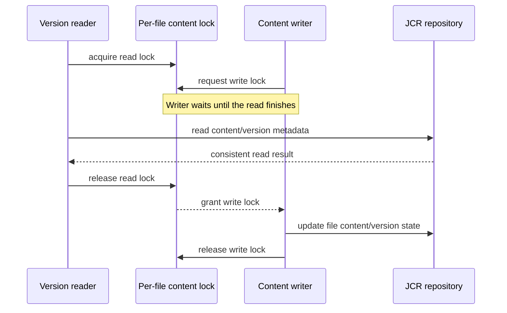

# BISERVER-15820: JCR version-read and content-write coordination

This document records the JCR version-read race tracked by BISERVER-15820, the lock contract used by the fix, and the validation performed on `master`. It is written for someone investigating why version reads and file-content mutations use the same per-file lock.

## Relationship to BISERVER-15667

BISERVER-15820 is separate from [BISERVER-15667](https://jira.pentaho.com/browse/BISERVER-15667) and PR #6395. PR #6395 prevents a non-read-only transaction from reusing a cached JCR session with stale version-history state. This issue coordinates concurrent reads and writes to a file's JCR content and version metadata. The lock fix does not replace the fresh-session behavior, and the fresh-session behavior does not serialize these concurrent operations.

## 1. The problem

Version metadata and versioned file content are read through `JcrRepositoryFileDao` while updates can change the same file's JCR state. Without a shared coordination point, a version read can overlap a content mutation and observe inconsistent state or fail during JCR version access.

The repository already has a per-file content lock abstraction. It is implemented as 64 fair `ReentrantReadWriteLock` stripes, selected by file ID. Writers take the write lock; because the locks are striped, different file IDs can occasionally share a stripe.

## 2. Solution

The version-read DAO methods now take the file's content read lock for the complete JCR template operation and release it in `finally`:

- `getVersionSummaries(fileId)`
- `getFile(fileId, versionId)`
- `getVersionSummary(fileId, versionId)`

The read side uses `JcrRepositoryFileUtils.getFileContentLock(fileId).readLock()`. Existing content mutations continue to use the corresponding write-lock contract. This allows reads of one file to coexist while preventing those reads from racing a writer of the same lock stripe.



## 3. Validation

The focused DAO and lock-utility tests passed on the `master` worktree:

```text
mvn -o -B -q -pl repository -Daudit -Djs.no.sandbox \
  -Dtest=JcrRepositoryFileDaoTest,JcrRepositoryFileUtilsTest test
```

These tests cover the DAO read-lock behavior and the shared lock utility. Full repository-module validation is still required through CI for this PR.

## 4. Scope and limits

This change coordinates JCR version reads with content mutations. It does not address cached-session ownership or stale session version-history views, which remain under BISERVER-15667. It also does not claim that unrelated file IDs always proceed independently: the fixed-size lock stripes can collide.

The initial PR targets `master`. Release-line backports should follow only after the master change is reviewed and validated.