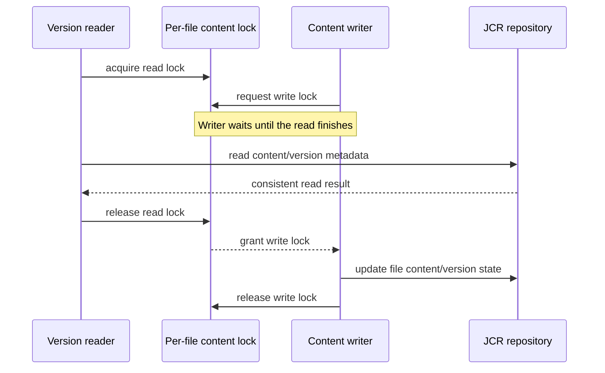

# BISERVER-15820: JCR version-read and content-write coordination

This document records the JCR version-read race tracked by BISERVER-15820, the lock contract used by the fix, and the validation performed on `master`. It is written for someone investigating why version reads and file-content mutations use the same per-file lock.

## Relationship to BISERVER-15667

BISERVER-15820 is separate from [BISERVER-15667](https://jira.pentaho.com/browse/BISERVER-15667) and PR #6395. PR #6395 prevents a non-read-only transaction from reusing a cached JCR session with stale version-history state. This issue coordinates concurrent reads and writes to a file's JCR content and version metadata. The lock fix does not replace the fresh-session behavior, and the fresh-session behavior does not serialize these concurrent operations.

## 1. The problem

Version metadata and versioned file content are read through `JcrRepositoryFileDao` while updates can change the same file's JCR state. Without a shared coordination point, a version read can overlap a content mutation and observe inconsistent state or fail during JCR version access.

The repository already has a per-file content lock abstraction. It is implemented as 64 fair `ReentrantReadWriteLock` stripes, selected by file ID. Writers take the write lock; because the locks are striped, different file IDs can occasionally share a stripe.

## 2. Solution

The version-read DAO methods now take the file's content read lock for the complete JCR template operation and release it in `finally`:

- `getVersionSummaries(fileId)`
- `getFile(fileId, versionId)`
- `getVersionSummary(fileId, versionId)`

The read side uses `JcrRepositoryFileUtils.getFileContentLock(fileId).readLock()`. Existing content mutations continue to use the corresponding write-lock contract. This allows reads of one file to coexist while preventing those reads from racing a writer of the same lock stripe.



### Write-side lock order

Writers take locks in one order so transactions that retain locks until completion cannot deadlock:

1. The global fair tree write lease (`FILE_CONTENT_TREE_LOCK`) is taken first by every writer: create, update, delete, permanent delete, undelete, copy/move, version delete and restore, and any single-stripe write reached through the check-in path (ACL, metadata, locale and folder updates).
2. The stripes for the full affected set are then taken in ascending index order in one acquisition. The set covers the target, its parent, their nearest versionable ancestors, moved or restored subtree IDs, and for version restore both the current and the restored (frozen) subtree.
3. Inside a Spring transaction, both the tree lease and the stripes are released in `afterCompletion`; otherwise they are released in `finally`. Re-acquiring the lease in the same transaction is reentrant.

Because writers are mutually exclusive on the tree lease, two transactions touching A then B and B then A cannot interleave. Readers take only their own stripe read lock.

## 3. Validation

The focused DAO and lock-utility tests passed on the `master` worktree:

```text
mvn -o -B -q -pl repository -Daudit -Djs.no.sandbox \
  -Dtest=JcrRepositoryFileDaoTest,JcrRepositoryFileUtilsTest test
```

These tests cover the DAO read-lock behavior, the shared lock utility, writers waiting on the tree lease, and the tree-before-stripe order for single-stripe writers. They use mocks, so the live runs below were added. Full repository-module validation is still required through CI for this PR.

### Live test setup

All live runs used the same machine, JDK 17 and PostgreSQL, one Pentaho Server at a time, reset to an empty repository before each run. The harness is `tools/repository-concurrency` (PR #6397).

| Server | Contents |
| --- | --- |
| Stock | 11.1 `suite-release` #454 unmodified |
| Patched | #454 with `pentaho-platform-repository` and the Kettle PUR plugin jar replaced by this PR's build; `pentaho-platform-extensions` was also replaced for the HTTP 409 check only |

### Single shared file (`jcr-concurrency-endpoint-bench.py`)

One versioned file, 20 import rounds per writer, 2 concurrent readers (file get and children list). Zero errors and no JCR signatures in the server log on both servers.

| Writers | Stock req/s | Patched req/s | Stock import p95 (ms) | Patched import p95 (ms) |
| --- | --- | --- | --- | --- |
| 1 | 68.9 | 78.6 | 66.9 | 37.2 |
| 2 | 78.6 | 102.0 | 84.8 | 35.9 |
| 4 | 94.4 | 125.3 | 60.8 | 24.6 |

Reader latency is unchanged within noise (file get p95 22-37 ms on both). The small runs (2 to 5 s) are a no-regression check, not a capacity measurement. On stock build #320 the same harness measured 92.5, 92.2 and 93.1 req/s at 1, 2 and 4 writers.

### Folder-tree scenarios (`jcr-concurrency-tree-scenarios.py`)

Move, trash/restore and ACL scenarios against the patched server: 0 errors, no HTTP 5xx and no log signatures. The 404 and 403 responses on descendant reads are expected while a folder is being moved or trashed, or when the reader is restricted. These were short smoke runs.

### Bulk mixed workload (`jcr-concurrency-bulk.py`)

300 s, 48 threads: version writes, version reads (REST and SOAP), downloads, move, copy, trash and restore, import/mkdir/delete churn, ACL writes, children, property and trash listings.

| Metric | Stock #454 | Patched |
| --- | --- | --- |
| Requests | 49,979 | 91,064 |
| Throughput (req/s) | 166.1 | 302.2 |
| Harness errors (HTTP 500 or SOAP fault beyond the expected "version not found") | 20 | 1 (trash listing, see "Trash listing") |
| JCR exception lines in the server log | 20 (`InvalidItemStateException`, `NoSuchItemStateException ... jcr:predecessors`) | 0 |
| Stalls or timeouts | none | none |

Selected operations (count, p50 / p95 ms):

| Operation | Stock | Patched |
| --- | --- | --- |
| version write | 3,237, 653 / 1,420 | 9,877, 221 / 383 |
| import (churn) | 1,128, 779 / 1,476 | 2,098, 226 / 388 |
| version summaries (SOAP) | 13,673, 229 / 418 | 25,817, 126 / 209 |
| file download | 2,544, 242 / 425 | 4,382, 138 / 227 |
| children list | 2,022, 240 / 425 | 3,757, 132 / 216 |
| trash list | 420, 220 / 405 | 503, 113 / 185 |
| move | 1,229, 235 / 419 | 1,282, 213 / 369 |
| restore | 420, 229 / 423 | 503, 229 / 395 |
| copy | 683, 897 / 1,129 | 403, 2,278 / 2,447 |

Stock produced 3 download 500s, 14 version-summary 500s and 2 file-get 500s. Patched produced none of these. Copy is the one operation that is slower: it takes the tree lease and the whole subtree's stripes, so concurrent copies serialize. Copy throughput on patched is 403 against 683 on stock while every other operation completes more work.

### Lost-update guard under serialization (`lost-update-probe.py`)

20 s per case on one versioned file; "accepted" is the number of versions created, "rejected" the number of `preventLostUpdate` rejections.

| Case | Stock (attempts / accepted / rejected / unexplained) | Patched |
| --- | --- | --- |
| 1 writer | 1,131 / 1,131 / 0 / 0 | 1,397 / 1,397 / 0 / 0 |
| 8 writers, 8 files | 0 rejected, 0 unexplained | 0 rejected, 0 unexplained |
| 2 writers, 1 file | 2,168 / 1,319 / 31 / 818 | 2,728 / 1,416 / 1,312 / 0 |
| 8 writers, 1 file | 5,730 / 2,110 / 1,587 / 2,033 | 6,430 / 2,332 / 4,070 / 28 |

The guard is a check-then-act. On stock, concurrent writers race past it and fail later with other errors or lose the update silently (the "unexplained" column). With the locks it is evaluated serially, so each conflicting writer gets the guard's explicit rejection. Accepted writes per second are equal or higher on patched; the higher rejection count is the same lost updates, now reported. Two overlapping writers produce one accepted and one rejected write, so about 50% is the optimistic-concurrency floor. Patched left 28 of 6,430 attempts (0.4%) unclassified at 8 writers, likely requests in flight at stop.

A rejected import now returns HTTP 409 with `PentahoPlatformImporter.ERROR_0009_PUBLISH_UPDATE_CONFLICT` (translated in all locale files) instead of HTTP 200. This was re-verified live with the probe after the change.

### Not covered

No Pentaho User Console run, no multi-node cluster, and no run with a non-default Jackrabbit configuration. The unexplained 0.1-0.5% residual above and `NoSuchItemStateException` entries in the patched log of a cumulative run are not classified. An ACL move-listener `NullPointerException` (`fromRegionCache` is null in `CachingPentahoEntryCollector`) appears on both stock and patched and is unrelated to these locks.

## 4. Scope and limits

This change coordinates JCR version reads with content mutations. It does not address cached-session ownership or stale session version-history views, which remain under BISERVER-15667. It also does not claim that unrelated file IDs always proceed independently: the fixed-size lock stripes can collide.

The initial PR targets `master`. Release-line backports should follow only after the master change is reviewed and validated.
### Versioned children during restore

`pho_mix:pentahoVersionable` extends `mix:simpleVersionable`, and no Pentaho child node definition uses `OnParentVersion` VERSION. Frozen nodes therefore never contain `nt:versionedChild` entries (those require full versioning with `jcr:childVersionHistory`), and restore cannot relocate a separately versioned child. The restore lock set is the current subtree, the frozen subtree identified by `jcr:frozenUuid`, and the current subtree of any existing node with a frozen UUID, since `restore(..., removeExisting=true)` deletes such a node (with its descendants) wherever it now lives.

### Trash listing

Listings are unlocked by design. `GET /files/deleted` (`DefaultDeleteHelper.getDeletedFiles`) can read a trash entry that a concurrent trash or restore has left half-written, which surfaced as a `NullPointerException` (`this.locked` is null) and a 500. This race also exists on stock builds and is independent of the content locks. The listing now skips such an entry (`NullPointerException`, `InvalidItemStateException`, `ItemNotFoundException`), logs it at debug as `Skipping trash entry that changed during listing`, and the next listing returns the settled entry. Only the main listing path is covered; the folder-filtered and legacy listings are unchanged.
