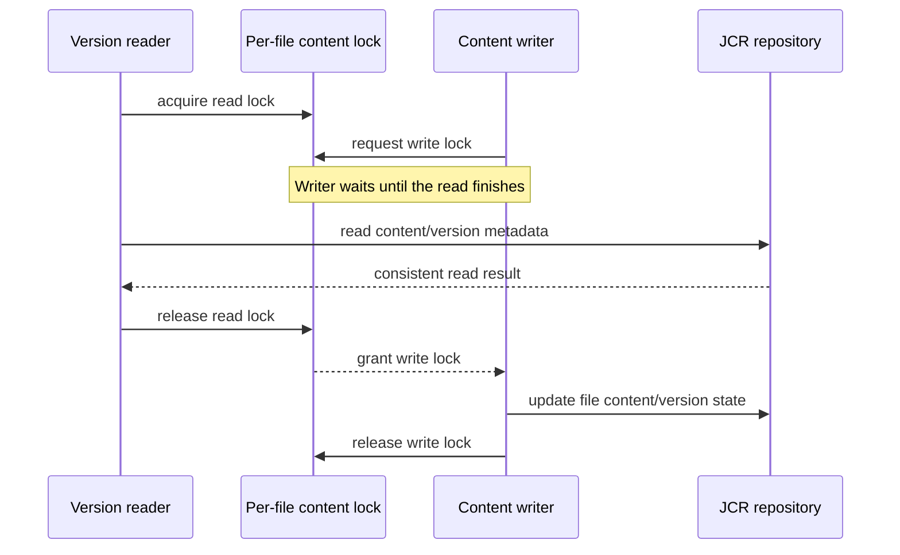

# BISERVER-15820: JCR version-read and content-write coordination

This document records the JCR version-read race tracked by BISERVER-15820, the lock contract used by the fix, and the validation performed on `master`. It is written for someone investigating why version reads and file-content mutations use the same per-file lock.

## Relationship to BISERVER-15667

BISERVER-15820 is separate from [BISERVER-15667](https://jira.pentaho.com/browse/BISERVER-15667) and PR #6395. PR #6395 prevents a non-read-only transaction from reusing a cached JCR session with stale version-history state. This issue coordinates concurrent reads and writes to a file's JCR content and version metadata. The lock fix does not replace the fresh-session behavior, and the fresh-session behavior does not serialize these concurrent operations.

## 1. The problem

Version metadata and versioned file content are read through `JcrRepositoryFileDao` while updates can change the same file's JCR state. Without a shared coordination point, a version read can overlap a content mutation and observe inconsistent state or fail during JCR version access.

The repository already has a per-file content lock abstraction. It is implemented as 64 fair `ReentrantReadWriteLock` stripes, selected by file ID. Writers take the write lock; because the locks are striped, different file IDs can occasionally share a stripe.

## 2. Solution

The version-read DAO methods now take the file's content read lock for the complete JCR template operation and release it in `finally`:

- `getVersionSummaries(fileId)`
- `getFile(fileId, versionId)`
- `getVersionSummary(fileId, versionId)`

The read side uses `JcrRepositoryFileUtils.getFileContentLock(fileId).readLock()`. Existing content mutations continue to use the corresponding write-lock contract. This allows reads of one file to coexist while preventing those reads from racing a writer of the same lock stripe.



### Write-side lock order

Writers take locks in one order so transactions that retain locks until completion cannot deadlock:

1. The global fair tree write lease (`FILE_CONTENT_TREE_LOCK`) is taken first by every writer: create, update, delete, permanent delete, undelete, copy/move, version delete and restore, and any single-stripe write reached through the check-in path (ACL, metadata, locale and folder updates).
2. The stripes for the full affected set are then taken in ascending index order in one acquisition. The set covers the target, its parent, their nearest versionable ancestors, moved or restored subtree IDs, and for version restore both the current and the restored (frozen) subtree.
3. Inside a Spring transaction, both the tree lease and the stripes are released in `afterCompletion`; otherwise they are released in `finally`. Re-acquiring the lease in the same transaction is reentrant.

Because writers are mutually exclusive on the tree lease, two transactions touching A then B and B then A cannot interleave. Readers take only their own stripe read lock.

## 3. Validation

The focused DAO and lock-utility tests passed on the `master` worktree:

```text
mvn -o -B -q -pl repository -Daudit -Djs.no.sandbox \
  -Dtest=JcrRepositoryFileDaoTest,JcrRepositoryFileUtilsTest test
```

These tests cover the DAO read-lock behavior, the shared lock utility, writers waiting on the tree lease, and the tree-before-stripe order for single-stripe writers. They use mocks and do not replace a bounded live concurrent import/read run, which is still required. Full repository-module validation is still required through CI for this PR.

## 4. Scope and limits

This change coordinates JCR version reads with content mutations. It does not address cached-session ownership or stale session version-history views, which remain under BISERVER-15667. It also does not claim that unrelated file IDs always proceed independently: the fixed-size lock stripes can collide.

The initial PR targets `master`. Release-line backports should follow only after the master change is reviewed and validated.
### Versioned children during restore

`pho_mix:pentahoVersionable` extends `mix:simpleVersionable`, and no Pentaho child node definition uses `OnParentVersion` VERSION. Frozen nodes therefore never contain `nt:versionedChild` entries (those require full versioning with `jcr:childVersionHistory`), and restore cannot relocate a separately versioned child. The restore lock set is limited to the current subtree and the frozen subtree identified by `jcr:frozenUuid`.
